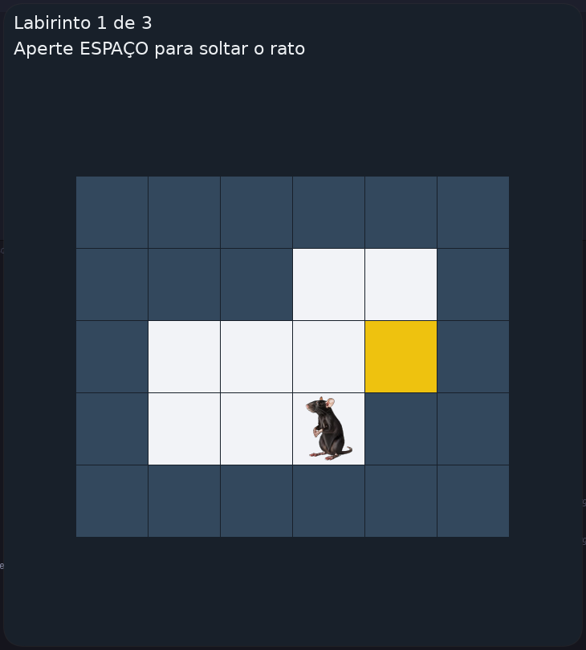
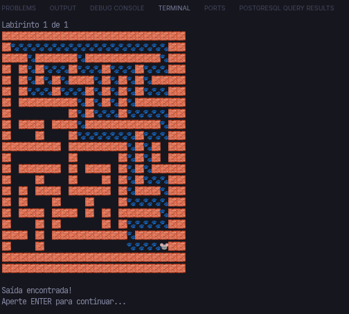

# Trapped Mouse 🐭🧀

Um rato preso em um labirinto procura a saída sozinho. O programa resolve o labirinto com **backtracking usando pilha** e mostra o rato andando, passo a passo, no terminal ou em uma janela gráfica.

<p align="center">
  
  
</p>

Projeto feito para a disciplina de Estrutura de Dados Lineares, como aplicação de pilha.

## Como rodar

Precisa de Python 3.13 ou mais novo.

Com [uv](https://docs.astral.sh/uv/):

```bash
uv run main.py
```

Ou com pip:

```bash
pip install pygame
python main.py
```

## Como usar

O programa faz duas perguntas e depois mostra a animação:

```
De onde vem o labirinto?
  1 - Arquivo
  2 - Teclado
  0 - Sair

Onde mostrar a animação?
  1 - Terminal
  2 - Interface gráfica
```

| Onde | Tecla | O que faz |
|---|---|---|
| Terminal | `ENTER` | Solta o rato; depois passa para o próximo labirinto |
| Interface | `ESPAÇO` | Solta o rato; depois passa para o próximo labirinto |
| Interface | `ESC` | Fecha o programa |

Quando os labirintos acabam, o menu aparece de novo.

## Formato do labirinto

O labirinto é um texto com quatro caracteres:

| Caractere | Significado |
|---|---|
| `0` | corredor |
| `1` | parede |
| `m` | posição do rato |
| `e` | saída |

Exemplo (`entrada1.txt`):

```
1100
000e
00m1
```

- O labirinto pode ter qualquer quantidade de linhas e colunas, desde que todas as linhas tenham o mesmo tamanho.
- Cada labirinto precisa ter exatamente um `m` e um `e`.
- Um arquivo pode ter vários labirintos, separados por uma linha vazia (veja `entrada_multipla.txt`).
- As paredes de fora não precisam estar no arquivo: o programa coloca uma moldura de paredes em volta.

## Como o rato acha a saída

1. O rato marca a célula onde está como visitada.
2. Ele empilha os vizinhos por onde ainda pode andar.
3. Se a pilha ficou vazia, não existe caminho.
4. Senão, ele desempilha uma célula e vai para ela.
5. Repete até chegar na saída.

Os vizinhos são empilhados na ordem cima, baixo, esquerda, direita. Como a pilha devolve primeiro o último que entrou, o rato testa na ordem contrária: direita, esquerda, baixo, cima.

Quando o rato entra em um beco sem saída, a próxima célula da pilha ficou para trás. Em vez de pular direto para ela, ele volta andando pelo caminho que fez, usando uma segunda pilha que guarda por onde passou.

## Arquivos

| Arquivo | O que tem |
|---|---|
| `pilha.py` | A estrutura de dados Pilha |
| `celula.py` | Uma posição do labirinto (linha e coluna) |
| `labirinto.py` | O mapa e o algoritmo que tira o rato do labirinto |
| `leitura.py` | Leitura e validação dos labirintos (arquivo e teclado) |
| `terminal.py` | Animação no terminal |
| `interface.py` | Animação gráfica com pygame |
| `main.py` | O menu |
| `entrada*.txt` | Labirintos de exemplo |

O terminal e a interface usam o mesmo algoritmo (`sairDoLabirinto`). Só muda a forma de desenhar cada passo.
